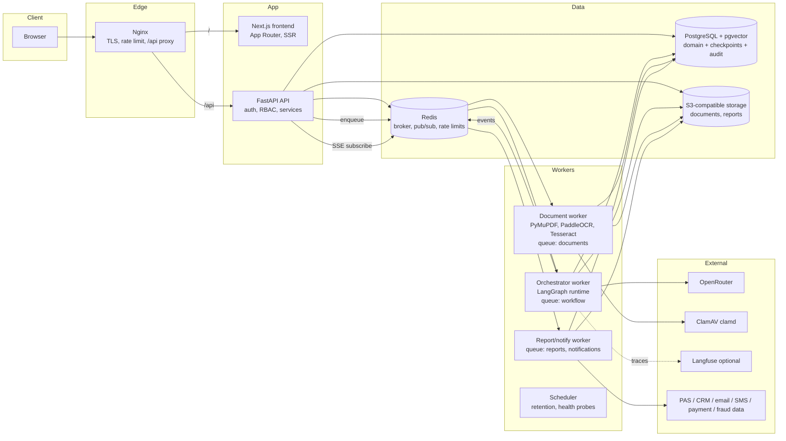

# ClaimOS — Architecture Overview (Phase 0)

Status: **Draft for approval** · Date: 2026-11-04 · Scope: Phase 0 only (no application code)

Related documents:

| # | Document | Content |
|---|----------|---------|
| 00 | this file | Context, architecture, principles, risks |
| 01 | [01-database-schema.md](01-database-schema.md) | Conventions, ERD, table definitions |
| 02 | [02-workflow.md](02-workflow.md) | Claim state machine, LangGraph graph, checkpointing, events |
| 03 | [03-agent-contracts.md](03-agent-contracts.md) | Agent responsibility matrix, typed I/O, rules engine, fraud scoring |
| 04 | [04-security-model.md](04-security-model.md) | AuthN/AuthZ, tenancy, file security, AI security, data protection |
| 05 | [05-api-specification.md](05-api-specification.md) | REST/SSE contracts, errors, pagination, idempotency |
| 06 | [06-roadmap-and-dependencies.md](06-roadmap-and-dependencies.md) | Performance budget, roadmap, dependencies, environment findings |
| ADR | [../adr/README.md](../adr/README.md) | Architecture decision records |

---

## 1. Environment inspection (2026-11-04)

| Item | Finding | Consequence |
|------|---------|-------------|
| Repository | Empty folder (`.claude/settings.local.json` only); **not a git repository** | Greenfield. `git init` recommended before Phase 1. |
| OS | Windows 11 Enterprise | Celery has no supported Windows worker; PaddleOCR on Windows is fragile → all workers run in Linux containers. |
| Node / pnpm | Node 23.11, npm 11.4, pnpm 10.9 | Node 23 is a non-LTS line. Pin frontend to **Node 24 LTS** in Docker and `.nvmrc`; local Node 23 works for dev. |
| Python | 3.12.10, `uv` 0.11 | Use `uv` for backend dependency management and lockfile. |
| Docker | CLI 29.7 installed, **daemon not running** | Docker Desktop must be started before Phase 1 verification. |
| PostgreSQL | No local `psql` | Provided by container (`pgvector/pgvector` image, PostgreSQL 16+). |
| Redis | Local `redis-server` 5.0.14 (legacy Windows port) | Too old (no ACL users, no Streams consumer features we may want). Use containerised Redis 8.6. |
| Tesseract | Not installed | Installed inside the document-worker image only. |

---

## 2. Architecture

### 2.1 Runtime topology



The browser only talks to Nginx. `/api/*` is reverse-proxied to FastAPI on the **same origin** as the Next.js
app, so session cookies are first-party and CORS is not required in production.

### 2.2 Logical layers (backend)

```
API routers (FastAPI)          ← HTTP/SSE, request validation, auth dependencies
  └─ Services                  ← business operations, authorization checks, transactions, audit emission
       ├─ Repositories         ← SQLAlchemy, always tenant-scoped
       ├─ Rules engine         ← pure deterministic functions (coverage, money, gates)
       ├─ Workflow facade      ← start / resume / cancel LangGraph executions (via task queue)
       └─ Integrations         ← provider interfaces (storage, PAS, email, AV, payment …)

Workflows (LangGraph)           ← graph definition, typed ClaimState, routing
  └─ Agents                    ← typed input → typed output; call Tools + Model Gateway; never touch the DB
       ├─ Tools                ← narrow, read-only, tenant-bound functions supplied by services
       └─ Model gateway        ← OpenRouter client, registry, capability checks, retries, budgets
Document processing             ← format detection, rendering, OCR, layout, hashing (no LLM)
```

**Dependency rule:** agents depend on tools and the model gateway only. Writes happen in workflow nodes via
services (`*_service.record_agent_output(...)`), never inside an agent. The rules engine depends on nothing
except typed value objects, so it is fully unit-testable.

### 2.3 Core design principles

1. **LLMs propose, code decides.** LLMs are used for perception and language (classifying documents,
   extracting fields, mapping a loss description to perils, normalising line items, writing explanations).
   Coverage status, money, fraud score, decision gating and approvals are deterministic code.
2. **Monotonic escalation.** An LLM output may only make a claim *more* cautious (e.g. downgrade to
   `MANUAL_REVIEW_REQUIRED`). It can never upgrade a deterministic outcome, remove a mandatory review or
   change a number.
3. **Evidence or nothing.** Every extracted value, finding and indicator carries a reference to a
   document/page/excerpt or a policy clause. Excerpts are verified against stored OCR text before acceptance
   (grounding check). Unsupported values become `null` + `missing`, never a guess.
4. **Human-governed decisions.** By default every final determination requires an authorised human. Optional
   straight-through processing (STP) can auto-finalise **approvals only**, behind an organisation setting,
   a compliance profile that permits it, and all gates passing. Automated rejection is never permitted.
5. **Tenant isolation in depth.** `organization_id` on every tenant row, repository scoping, composite
   foreign keys and PostgreSQL Row-Level Security.
6. **Versioned everything that affects a decision.** Policy versions, rule sets, prompts, model
   assignments, compliance profiles and reports are versioned; each agent run records exactly which ones it used.
7. **Real or clearly labelled.** Development adapters (local storage, console email, mock AI provider,
   disabled AV) are explicit, logged at start-up, shown in the UI system-health panel, and refused when
   `APP_ENV=production`.

### 2.4 Product scope for the first release

To keep the rules engine concrete and testable, v1 ships two configurable insurance products:

| Product | Typical documents | Calculation features |
|---------|-------------------|----------------------|
| **Motor – own damage** | claim form, ID, vehicle registration, accident/police report, repair estimate/invoice, photos | per-occurrence deductible, sum insured, depreciation schedule on parts, salvage |
| **Health – medical expense** | claim form, ID, hospital report, medical bill, bank details | waiting periods, annual aggregate limit, per-item sub-limits, co-payment % |

Products are configuration (`insurance_products` + versioned `rule_sets`), so property/travel can be added
without code changes to the engine, only new rule types if needed.

### 2.5 Source of truth for policies

The authoritative policy is the **structured policy version** stored in ClaimOS (created through the Policy
Management UI, JSON import, or the PAS integration adapter). A policy PDF uploaded with a claim is treated as
*supporting evidence* (e.g. to cross-check the policy number and holder name); it is **never** parsed into
coverage terms automatically. This prevents an uploaded or tampered document from defining its own coverage.

---

## 3. Architectural risks

| # | Risk | Impact | Likelihood | Mitigation |
|---|------|--------|------------|------------|
| R1 | **Free OpenRouter models**: low rate limits, daily caps, variable latency, models disappearing, many lacking vision / JSON schema support | 4-min target missed; workflow failures | High | Capability probes before assignment; fallback chains; per-model throttling; token & time budgets; mock provider for tests; benchmark with paid models separately and report both. |
| R2 | **Data protection with third-party endpoints**: free endpoints may log/train on prompts | Regulatory/contractual breach | High | `model_registry.data_policy`; org-level `ai_data_processing_approved` flag; real (non-synthetic) claims can only route to models whose data policy is approved; default dev data is synthetic. |
| R3 | **LLM hallucination** in extraction or policy interpretation | Wrong payouts | Medium | Grounding check of excerpts vs OCR text; clause-ID validation; low-confidence → human verification; deterministic engine owns outcomes. |
| R4 | **Prompt injection via documents** | Manipulated recommendations | Medium | Documents passed as delimited data; no mutating tools; schema-constrained outputs; injection heuristics raise a fraud/compliance indicator; monotonic escalation. |
| R5 | **OCR quality/latency** (PaddleOCR CPU cost, poor scans) | Latency and accuracy | Medium | Text-layer-first for born-digital PDFs; page-level parallel OCR; start OCR at upload time; Tesseract fallback; quality score per page; page limits. |
| R6 | **LangGraph + task queue interplay** (long-running graphs inside Celery, resume after interrupt, worker crash) | Stuck or duplicated workflows | Medium | Postgres checkpointer; idempotent nodes keyed by `(execution_id, node, attempt)`; separate worker pools per queue (no worker waits on its own queue); visibility timeouts; stale-execution reaper. |
| R7 | **Checkpoint state vs domain tables divergence** | Inconsistent UI/audit | Medium | Domain tables are the business source of truth; graph state holds IDs + summaries; node writes and event emission in one DB transaction (outbox). |
| R8 | **Langfuse self-hosting weight** (v3 needs ClickHouse, Redis, S3) | Dev environment bloat | Medium | Langfuse is an optional compose profile / external SaaS; OpenTelemetry + DB `agent_runs` are always on. |
| R9 | **Regulatory variance** across jurisdictions | Non-compliant decisions | Medium | Configurable compliance profiles; shipped profiles are labelled *examples requiring legal review*; no claim of regulatory certification. |
| R10 | **Scope size** (15 nav areas, 9 agents, 40+ tables) | Delivery slip, shallow features | High | Strict phase gates; each phase has acceptance tests; UI areas only appear when backed by real endpoints. |
| R11 | **Fraud model bias / false positives** | Unfair treatment | Medium | Indicators, not verdicts; documented weights; human review required; false-positive tracking from reviewer outcomes. |
| R12 | **Windows development host** | Tooling friction | Low | Everything runtime-critical in containers; host only runs editors, Node dev server optional. |
| R13 | **Monetary errors** (float, rounding, currency mixing) | Financial loss | Low | `Decimal` everywhere, `NUMERIC(19,4)`, explicit currency per amount, ISO-4217 exponent table, single rounding point, property-based tests. |

---

## 4. Non-functional targets (summary)

Detail in [06-roadmap-and-dependencies.md](06-roadmap-and-dependencies.md#1-performance-targets).

* Simple claim (≤ 5 documents, ≤ 20 pages, born-digital or good scans): **P50 ≤ 180 s, P90 ≤ 240 s**
  from `process` request to `DECISION_PENDING`/`HUMAN_REVIEW`, measured — not assumed.
* API P95 < 300 ms for reads (excluding exports); SSE event latency < 1 s from node completion.
* Availability target for a single-region deployment: 99.5% (no HA claims before Phase 13).
* The 4-minute claim is only published when Phase 14 benchmark evidence supports it.
