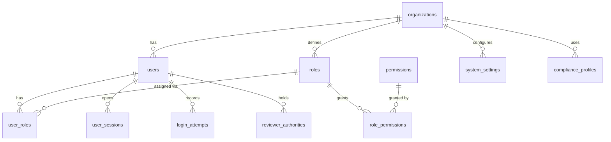
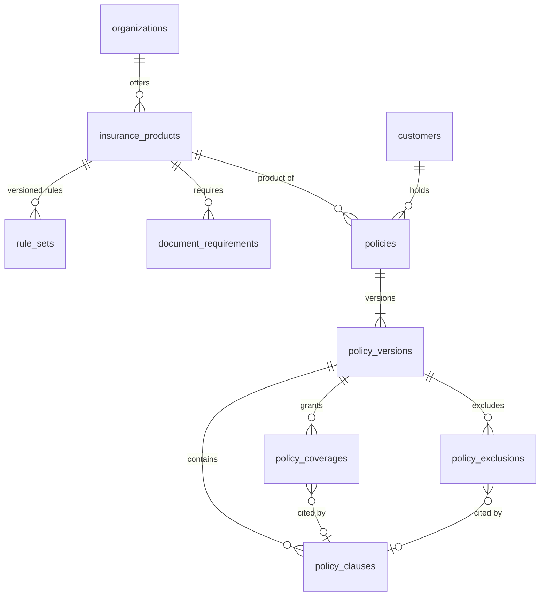
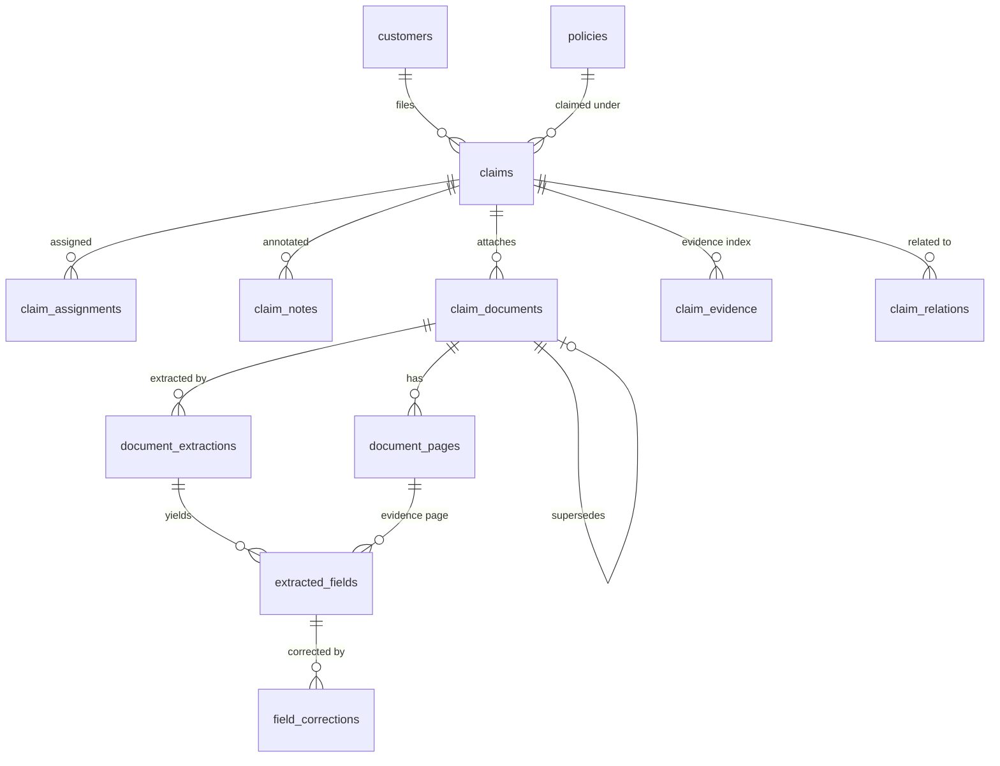
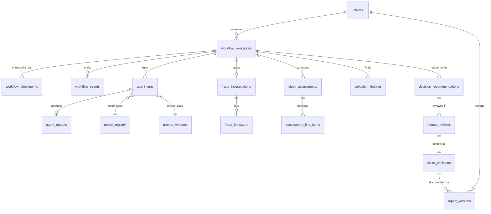
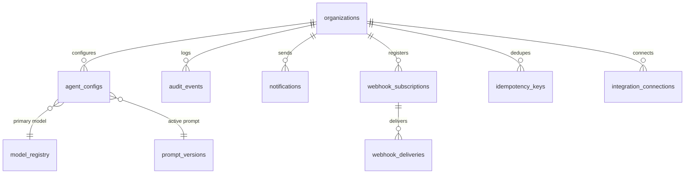

# 01 — Database Schema

PostgreSQL 16+ with extensions `pgcrypto` (UUIDs), `citext` (emails), `pg_trgm` (search), `vector` (Phase 12).
Migrations: Alembic, one revision per phase minimum, never edited after merge.

## 1. Conventions

| Rule | Detail |
|------|--------|
| Primary keys | `id UUID DEFAULT gen_random_uuid()` (UUIDv7 generated app-side once supported by the driver, for index locality) |
| Tenancy | Every tenant-owned table has `organization_id UUID NOT NULL`. Child FKs are composite: `(organization_id, parent_id) → parent(organization_id, id)`, backed by `UNIQUE (organization_id, id)` on the parent. |
| RLS | `ALTER TABLE … ENABLE ROW LEVEL SECURITY; CREATE POLICY tenant ON … USING (organization_id = current_setting('app.org_id')::uuid)`. App role `claimos_app` has no `BYPASSRLS`. |
| Timestamps | `created_at`, `updated_at TIMESTAMPTZ NOT NULL DEFAULT now()`; `updated_at` maintained by trigger. All times UTC. |
| Soft delete | `deleted_at TIMESTAMPTZ NULL` on user-facing aggregates (claims, customers, policies, documents, users, notes). Partial indexes `WHERE deleted_at IS NULL`. |
| Optimistic locking | `row_version INT NOT NULL DEFAULT 1` on mutable aggregates (claims, policies, reviews, settings). |
| Money | `amount NUMERIC(19,4)` + `currency CHAR(3)` (ISO-4217). Never float. |
| Enums | PostgreSQL `TEXT` + `CHECK` constraints (easier migrations than native enums), mirrored by Python `StrEnum`. |
| JSON | `JSONB` only for versioned, schema-validated payloads (agent outputs, rule configs); queried fields are real columns. |
| Immutability | `audit_events`, `workflow_events`, `agent_runs` (after completion), `policy_versions` (after publish), `claim_decisions`, `report_versions` are append-only (trigger + grants). |

## 2. Entity-relationship diagrams

### 2.1 Identity & tenancy

### 2.2 Products, policies, customers

### 2.3 Claims & documents

### 2.4 Workflow, agents, decisions

### 2.5 Platform

## 3. Table definitions

Columns `id`, `organization_id`, `created_at`, `updated_at` are implied where marked **[T]** (tenant table).
`deleted_at` is implied where marked **[SD]**. FK targets in brackets.

### 3.1 Identity & tenancy

| Table | Key columns | Indexes / constraints |
|-------|-------------|------------------------|
| `organizations` | id, name, slug (unique), status (`active/suspended`), default_currency, default_timezone, jurisdiction_code, compliance_profile_id, ai_data_processing_approved BOOL, ai_data_approval_ref, settings_version | unique(slug) |
| `users` [T][SD] | email CITEXT, display_name, password_hash (argon2id), status (`invited/active/disabled/locked`), mfa_secret_enc NULL, last_login_at, failed_login_count, locked_until, password_changed_at, is_platform_admin BOOL | unique(organization_id, email) where deleted_at is null |
| `roles` [T] | key (`super_admin, org_admin, claims_manager, claims_adjuster, fraud_investigator, compliance_officer, reviewer, auditor`), name, is_system BOOL | unique(organization_id, key) |
| `permissions` | key (e.g. `claims.read`, `claims.write`, `reviews.decide`), description — global catalogue | unique(key) |
| `role_permissions` | role_id, permission_id, organization_id | pk(role_id, permission_id) |
| `user_roles` [T] | user_id, role_id, granted_by, expires_at NULL | unique(user_id, role_id) |
| `reviewer_authorities` [T] | user_id, product_id NULL (=all), max_approval_amount, currency, can_reject BOOL, can_override_fraud BOOL, valid_from, valid_to | idx(user_id) |
| `user_sessions` [T] | user_id, token_hash BYTEA, csrf_hash, ip, user_agent, created_at, last_seen_at, idle_expires_at, absolute_expires_at, revoked_at, revoke_reason | unique(token_hash); idx(user_id) |
| `login_attempts` | organization_id NULL, email_hash, user_id NULL, ip, success BOOL, reason, created_at | idx(email_hash, created_at), idx(ip, created_at) |
| `compliance_profiles` [T] | key, version, jurisdiction_code, rules JSONB (validated schema), is_example BOOL, published_at, published_by | unique(organization_id, key, version) |
| `system_settings` [T] | namespace (`approval`, `retention`, `processing`, `notifications`, `currency`), key, value JSONB, row_version, updated_by | unique(organization_id, namespace, key) |

### 3.2 Products, customers, policies

| Table | Key columns | Notes |
|-------|-------------|-------|
| `insurance_products` [T] | code, name, line (`motor/health/property/travel`), currency, status | unique(organization_id, code) |
| `rule_sets` [T] | product_id, version, status (`draft/published/retired`), effective_from, config JSONB (deductible, depreciation, sub-limit, co-pay, STP thresholds, fraud weights), checksum, published_by, published_at | unique(product_id, version); published rows immutable |
| `document_requirements` [T] | product_id, rule_set_id, document_type, mandatory BOOL, condition JSONB NULL (e.g. "police_report if third_party_involved"), extraction_schema JSONB | |
| `customers` [T][SD] | external_ref, customer_type (`individual/business`), full_name, date_of_birth NULL, national_id_hash NULL, national_id_last4 NULL, email, phone, address JSONB, pii_encrypted JSONB (envelope-encrypted extras) | idx trigram(full_name); unique(organization_id, external_ref) |
| `policies` [T][SD] | policy_number, customer_id, product_id, status (`active/lapsed/cancelled/expired`), source (`manual/import/pas`), external_ref | unique(organization_id, policy_number) |
| `policy_versions` [T] | policy_id, version_no, effective_from DATE, effective_to DATE, inception_date, expiry_date, sum_insured, currency, deductible_amount, annual_aggregate_limit NULL, waiting_period_days NULL, endorsements JSONB, source_document_ref NULL, status (`draft/published/superseded`), published_at, checksum | unique(policy_id, version_no); EXCLUDE overlapping `daterange(effective_from, effective_to)` per policy for published versions |
| `policy_clauses` [T] | policy_version_id, clause_ref (e.g. `4.2(b)`), title, section (`coverage/exclusion/condition/definition/endorsement`), text, page_ref NULL | unique(policy_version_id, clause_ref) |
| `policy_coverages` [T] | policy_version_id, coverage_code (`own_damage`, `theft`, `inpatient`, …), perils TEXT[], limit_amount, sub_limits JSONB, deductible_override NULL, co_pay_pct NULL, waiting_period_days NULL, clause_id | |
| `policy_exclusions` [T] | policy_version_id, exclusion_code, applies_to_coverage_codes TEXT[], condition JSONB (machine-checkable predicate or `requires_interpretation`), clause_id | |

### 3.3 Claims & documents

| Table | Key columns | Notes |
|-------|-------------|-------|
| `claims` [T][SD] | claim_reference (e.g. `CLM-2026-000123`, per-org sequence), customer_id, policy_id, policy_version_id NULL (resolved), product_id, status (see 02 §1), category, priority (`low/normal/high/urgent`), incident_date, incident_time NULL, reported_at, incident_location JSONB, description, claimed_amount, currency, channel, is_synthetic BOOL, duplicate_of_claim_id NULL, current_execution_id NULL, row_version | unique(organization_id, claim_reference); idx(organization_id, status, priority); idx(policy_id, incident_date) |
| `claim_assignments` [T] | claim_id, user_id, role_on_claim (`adjuster/reviewer/investigator`), assigned_by, assigned_at, unassigned_at NULL | partial unique(claim_id, role_on_claim) where unassigned_at is null |
| `claim_notes` [T][SD] | claim_id, author_id, visibility (`internal/restricted`), body | |
| `claim_relations` [T] | claim_id, related_claim_id, relation (`duplicate_suspected/same_incident/same_party`), source (`rule/manual`), score | |
| `claim_documents` [T][SD] | claim_id, version_no, supersedes_id NULL, original_filename, declared_mime, detected_mime, size_bytes, sha256, perceptual_hash NULL, text_simhash NULL, storage_key, storage_bucket, encryption_key_id, scan_status (`pending/clean/infected/skipped_dev/error`), processing_status (`queued/processing/processed/failed/needs_review`), document_type NULL, classification_confidence, page_count, uploaded_by, quality_score | idx(organization_id, sha256); idx(claim_id) |
| `document_pages` [T] | document_id, page_number, text_source (`text_layer/paddleocr/tesseract`), text, ocr_confidence, layout JSONB (blocks with bboxes), image_storage_key, width, height, quality_flags TEXT[] | unique(document_id, page_number); GIN trigram on text (Phase 4) |
| `document_extractions` [T] | document_id, agent_run_id, extraction_schema_version, status (`completed/partial/failed`), attempt | |
| `extracted_fields` [T] | extraction_id, document_id, field_name, value_text, value_normalized JSONB, value_type, confidence, page_id, page_number, evidence_excerpt, bbox JSONB NULL, grounding_status (`grounded/ungrounded/not_applicable`), validation_status (`verified/unverified/low_confidence/conflict/corrected/rejected`), is_current BOOL | idx(document_id, field_name) |
| `field_corrections` [T] | extracted_field_id, previous_value, new_value, reason, corrected_by, audit_event_id | append-only |
| `claim_evidence` [T] | claim_id, evidence_type (`field/page/clause/indicator/line_item`), ref_table, ref_id, label, summary | evidence index used by reports and UI deep links |

### 3.4 Workflow & agents

| Table | Key columns | Notes |
|-------|-------------|-------|
| `workflow_executions` [T] | claim_id, graph_name, graph_version, thread_id (LangGraph), status (`queued/running/interrupted/completed/failed/cancelled`), current_node, trigger (`initial/resume/reassessment/more_info`), started_by, started_at, finished_at, duration_ms, iteration_count, reassessment_count, token_budget, tokens_used, cost_usd NUMERIC(12,6), error_code, error_detail, idempotency_key, celery_task_id | partial unique(claim_id) where status in (queued, running) — one active execution per claim |
| `workflow_checkpoints` [T] | execution_id, checkpoint_id, checkpoint_ns, node, created_at | Index of LangGraph checkpoints; payloads live in the checkpointer's own tables (`checkpoints`, `checkpoint_blobs`, `checkpoint_writes`) — those are accessed only by the orchestrator role. |
| `workflow_events` [T] | execution_id, claim_id, seq BIGINT, event_type (`node_started/node_completed/node_failed/retry/interrupt/resumed/status_changed/progress`), node, agent_key, payload JSONB (non-sensitive), occurred_at | unique(execution_id, seq); outbox for SSE |
| `agent_runs` [T] | execution_id, claim_id, agent_key, node, attempt, status (`running/succeeded/failed/skipped/timed_out`), started_at, finished_at, duration_ms, model_registry_id NULL, model_slug, prompt_version_id NULL, rule_set_id NULL, input_hash, prompt_tokens, completion_tokens, cost_usd, error_code, error_detail, trace_id | unique(execution_id, node, attempt); idx(agent_key, started_at) |
| `agent_outputs` [T] | agent_run_id, schema_name, schema_version, output JSONB, validation_errors JSONB, output_hash | 1:1 with successful/partial runs |
| `agent_configs` [T] | agent_key, enabled, model_role, primary_model_id, fallback_model_ids UUID[], prompt_version_id, confidence_threshold, max_retries, timeout_seconds, max_tokens, temperature, row_version | unique(organization_id, agent_key) |
| `model_registry` | org NULL (=global), provider, slug (e.g. `meta-llama/…:free`), display_name, is_free, context_length, capabilities JSONB (`json_mode, json_schema, tools, vision` each with `declared/verified/tested_at`), data_policy (`unknown/may_log/no_training/zero_retention`), pricing JSONB, status (`active/degraded/disabled`), last_health_at, p50_latency_ms | unique(org, slug) |
| `prompt_versions` | org NULL, agent_key, version, template_path, content_sha256, content TEXT, change_note, created_by, evaluated_at, eval_score NULL, status (`draft/active/retired`) | unique(org, agent_key, version); prompt files are source-controlled, rows mirror them |

### 3.5 Findings, assessment, decision

| Table | Key columns | Notes |
|-------|-------------|-------|
| `fraud_investigations` [T] | claim_id, execution_id, risk_score SMALLINT 0–100, risk_level (`low/medium/high/critical`), scoring_framework_version, recommended_action (`continue/review/investigate`), status (`open/closed_no_issue/closed_confirmed/referred`), assigned_to NULL, outcome_label NULL (for evaluation) | |
| `fraud_indicators` [T] | investigation_id, rule_code, source (`rule/statistical/llm`), severity, weight, confidence, contribution, description, evidence JSONB (refs), missing_evidence JSONB | |
| `claim_assessments` [T] | claim_id, execution_id, rule_set_id, policy_version_id, currency, gross_claimed, gross_eligible, depreciation_total, deductible_applied, co_pay_applied, limit_remaining_before, limit_capped_amount, eligible_payout, rounding_policy, calculation_trace JSONB, status (`calculated/insufficient_inputs/superseded`) | |
| `assessment_line_items` [T] | assessment_id, line_no, description, category, coverage_code NULL, quantity NUMERIC(12,3), unit_amount, claimed_amount, eligible_amount, depreciation_pct, status (`eligible/partially_eligible/ineligible/unsupported/duplicate`), reason_code, evidence_field_ids UUID[] | |
| `validation_findings` [T] | execution_id, claim_id, check_code, severity (`info/warning/error/critical`), field_name NULL, observed_values JSONB, evidence JSONB, required_correction, resolved_at NULL | |
| `coverage_determinations` [T] | execution_id, claim_id, policy_version_id, coverage_code, status (`covered/potentially_covered/not_covered/insufficient_evidence/requires_manual_interpretation`), reasons JSONB, clause_ids UUID[] | |
| `decision_recommendations` [T] | claim_id, execution_id, recommendation (`APPROVE_RECOMMENDED/REJECT_RECOMMENDED/MANUAL_REVIEW_REQUIRED/MORE_INFORMATION_REQUIRED/PENDING_VERIFICATION`), deterministic_outcome, llm_escalated BOOL, gates JSONB, explanation, supporting_evidence JSONB, contradictory_evidence JSONB, missing_information JSONB, mandatory_review_reasons TEXT[] | |
| `human_reviews` [T] | claim_id, recommendation_id, assigned_to, status (`pending/in_progress/completed/escalated/cancelled`), priority_score, due_at, required_authority JSONB, four_eyes_required BOOL, row_version | idx(organization_id, status, priority_score DESC) |
| `claim_decisions` [T] | claim_id, review_id NULL, decision (`approved/rejected/more_information/escalated/returned`), approved_amount NULL, currency, decided_by NULL (NULL only for STP approval), decision_mode (`human/stp`), override BOOL, override_reason, before_state JSONB, after_state JSONB, second_approver_id NULL | append-only |
| `report_versions` [T] | claim_id, decision_id NULL, version_no, format (`pdf/json`), storage_key, sha256, generated_by, generated_at, template_version | unique(claim_id, version_no, format) |

### 3.6 Platform & integrations

| Table | Key columns | Notes |
|-------|-------------|-------|
| `audit_events` [T] | seq BIGINT, occurred_at, actor_type (`user/system/agent/integration`), actor_id, action (e.g. `claim.created`, `field.corrected`, `review.decided`), entity_type, entity_id, claim_id NULL, request_id, ip, before JSONB, after JSONB (redacted), prev_hash, hash | unique(organization_id, seq); idx(entity_type, entity_id); idx(claim_id); BRIN(occurred_at) |
| `notifications` [T] | user_id NULL, channel (`in_app/email/sms/webhook`), template_key, payload JSONB, status (`pending/sent/failed/read`), sent_at, read_at, provider_message_id | |
| `webhook_subscriptions` [T] | url, secret_enc, event_types TEXT[], active, created_by | |
| `webhook_deliveries` [T] | subscription_id, event_type, payload_hash, attempt, status, response_code, next_attempt_at | |
| `integration_connections` [T] | kind (`pas/crm/storage/email/sms/payment/fraud_data`), provider, config JSONB (no secrets), secret_ref (secret-manager key), status, last_tested_at | |
| `idempotency_keys` [T] | key, user_id, method, path, request_hash, response_status, response_body JSONB, expires_at | unique(organization_id, user_id, key) |
| `retention_jobs` [T] | entity_type, policy_key, run_at, items_affected, status, legal_hold_skipped | Phase 13 |

### 3.7 Additions vs. the brief

Tables added beyond the requested list, each needed by a stated requirement: `role_permissions`,
`reviewer_authorities` (approval authority), `user_sessions`, `login_attempts` (brute-force/login monitoring),
`compliance_profiles`, `insurance_products`, `rule_sets`, `document_requirements` (configurable rules/required
docs), `policy_clauses` (citations), `field_corrections` (correction audit), `claim_relations`,
`workflow_events` (real-time outbox), `agent_configs`, `validation_findings`, `coverage_determinations`,
`report_versions`, `webhook_*`, `integration_connections`, `idempotency_keys`, `retention_jobs`.

## 4. Data-access roles

| DB role | Rights |
|---------|--------|
| `claimos_migrator` | DDL; used only by Alembic. |
| `claimos_app` | DML on domain tables under RLS; INSERT-only on append-only tables; no access to checkpointer tables. |
| `claimos_worker` | Same as app + checkpointer tables. |
| `claimos_platform_admin` | `BYPASSRLS`, used only by audited platform-admin services (org provisioning). |
| `claimos_readonly` | SELECT for reporting/backup verification. |
