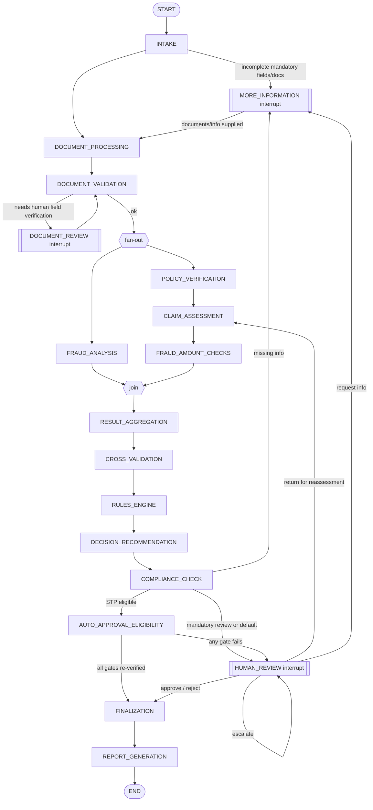

# 02 — Claim State Machine & LangGraph Workflow

Two separate state concepts:

* **Claim status** (`claims.status`) — business lifecycle, shown to users, changed only by services.
* **Graph node** (`workflow_executions.current_node`) — orchestration position inside one execution.

## 1. Claim status machine

```mermaid
stateDiagram-v2
  [*] --> SUBMITTED
  SUBMITTED --> DOCUMENT_PROCESSING: process requested
  DOCUMENT_PROCESSING --> DOCUMENT_REVIEW: low-confidence / unreadable docs
  DOCUMENT_REVIEW --> DOCUMENT_PROCESSING: fields verified / reprocess
  DOCUMENT_PROCESSING --> POLICY_VERIFICATION
  POLICY_VERIFICATION --> FRAUD_ANALYSIS: (parallel; status shows the slowest open stage)
  FRAUD_ANALYSIS --> CLAIM_ASSESSMENT
  CLAIM_ASSESSMENT --> VALIDATION
  VALIDATION --> DECISION_PENDING
  DECISION_PENDING --> HUMAN_REVIEW
  DECISION_PENDING --> AWAITING_INFORMATION
  DECISION_PENDING --> APPROVED: STP enabled and all gates pass
  HUMAN_REVIEW --> APPROVED
  HUMAN_REVIEW --> REJECTED
  HUMAN_REVIEW --> AWAITING_INFORMATION
  HUMAN_REVIEW --> CLAIM_ASSESSMENT: returned for reassessment
  HUMAN_REVIEW --> HUMAN_REVIEW: escalated (new reviewer)
  AWAITING_INFORMATION --> DOCUMENT_PROCESSING: information supplied
  APPROVED --> COMPLETED: report generated
  REJECTED --> COMPLETED: report generated
  DOCUMENT_PROCESSING --> FAILED
  POLICY_VERIFICATION --> FAILED
  CLAIM_ASSESSMENT --> FAILED
  FAILED --> DOCUMENT_PROCESSING: retry from last checkpoint
  COMPLETED --> [*]
```



Transition rules are encoded in `claim_status_service.ALLOWED_TRANSITIONS`; any other transition raises
`InvalidTransition` and is audited. `APPROVED`/`REJECTED` require a `claim_decisions` row in the same transaction.
`REJECTED` can never be reached without a human decision.

## 2. Graph



Dependency notes:

* `POLICY_VERIFICATION` and `FRAUD_ANALYSIS` (prior-claim, duplicate, date and identity checks) run concurrently
  once document validation passes.
* `CLAIM_ASSESSMENT` waits for policy verification (it needs the resolved policy version, coverages and limits).
* `FRAUD_AMOUNT_CHECKS` (amount anomaly, repair-estimate outliers, duplicate line items) needs assessed line
  items, so it follows assessment. The join waits for both fraud branches.
* `FINALIZATION` is only reachable after `COMPLIANCE_CHECK` and either a human decision or the STP gate.

## 3. Node catalogue

| Node | Implementation | Claim status set | Writes (via services) | Failure behaviour |
|------|----------------|------------------|-----------------------|-------------------|
| INTAKE | Intake agent (deterministic + optional LLM categorisation) | `SUBMITTED` | priority, category, missing items, duplicate relations | validation errors → MORE_INFO |
| DOCUMENT_PROCESSING | waits for/dispatches per-document pipeline on `documents` queue; then Document Intelligence agent per doc | `DOCUMENT_PROCESSING` | pages, extractions, fields | per-doc retry ×2; unreadable → doc `needs_review` |
| DOCUMENT_VALIDATION | deterministic: confidence thresholds, grounding, required doc types present | — | validation findings | low confidence → DOCUMENT_REVIEW interrupt |
| POLICY_VERIFICATION | Policy agent | `POLICY_VERIFICATION` | resolved `policy_version_id`, coverage determinations | no applicable version → finding + MORE_INFO/HUMAN_REVIEW |
| FRAUD_ANALYSIS | Fraud agent (stage 1) | `FRAUD_ANALYSIS` | investigation, indicators | LLM step optional; rule step must succeed |
| CLAIM_ASSESSMENT | Assessment agent + rules engine money functions | `CLAIM_ASSESSMENT` | assessment, line items | insufficient inputs → status `insufficient_inputs` (not a failure) |
| FRAUD_AMOUNT_CHECKS | Fraud agent (stage 2, deterministic/statistical) | — | indicators, final score | — |
| RESULT_AGGREGATION | Supervisor: validates every branch output against schema, detects contradictions between agents | — | — | missing branch output → retry branch once, then HUMAN_REVIEW |
| CROSS_VALIDATION | Validation agent | `VALIDATION` | validation findings | — |
| RULES_ENGINE | pure functions | — | gates result (stored with recommendation) | exception → FAILED (bug, not recoverable silently) |
| DECISION_RECOMMENDATION | Decision agent (deterministic outcome + LLM explanation/escalation) | `DECISION_PENDING` | recommendation | LLM failure → deterministic template explanation + `MANUAL_REVIEW_REQUIRED` |
| COMPLIANCE_CHECK | Compliance agent (deterministic) | — | compliance findings | blocking finding → HUMAN_REVIEW |
| AUTO_APPROVAL_ELIGIBILITY | rules engine STP gate (re-evaluated from persisted data, not from state) | — | — | any doubt → HUMAN_REVIEW |
| HUMAN_REVIEW | `interrupt({"review_id": …})` | `HUMAN_REVIEW` | human review row | resumes only via authorised API |
| MORE_INFO | `interrupt({"requested_items": …})` | `AWAITING_INFORMATION` | notification to customer/adjuster | expiry timer → reminder, then HUMAN_REVIEW |
| FINALIZATION | service: write `claim_decisions`, status `APPROVED/REJECTED` | `APPROVED`/`REJECTED` | decision, audit | transactional |
| REPORT_GENERATION | enqueue report task, await | `COMPLETED` | report version | report failure does not undo decision; retried by reports queue |

## 4. Shared typed state

State holds **identifiers and compact summaries**; full records live in domain tables. Defined as Pydantic models
(LangGraph supports Pydantic state) with reducers for parallel branches.

```python
class ClaimState(BaseModel):
    # identity / control
    organization_id: UUID
    claim_id: UUID
    execution_id: UUID
    graph_version: str
    trigger: Literal["initial", "resume", "reassessment", "more_info"]
    data_classification: Literal["synthetic", "real"]       # drives model data-policy routing
    iteration: int = 0                                      # global node-visit counter
    reassessment_count: int = 0
    tokens_used: int = 0
    # results (each is a typed summary + DB id)
    intake: IntakeResult | None = None
    documents: Annotated[list[DocumentSummary], merge_by_id] = []
    document_validation: DocumentValidationResult | None = None
    policy: PolicyVerificationResult | None = None
    fraud: Annotated[FraudSummary | None, merge_fraud_stages] = None
    assessment: AssessmentResult | None = None
    validation: CrossValidationResult | None = None
    gates: RulesEngineResult | None = None
    recommendation: DecisionRecommendationResult | None = None
    compliance: ComplianceResult | None = None
    human_decision: HumanDecision | None = None
    # bookkeeping
    errors: Annotated[list[NodeError], operator.add] = []
    completed_nodes: Annotated[set[str], set_union] = set()
```

Every node returns a partial update; the supervisor validates the update against the node's output schema before
it is merged. Uploaded document text never enters the state — only IDs, classifications and validated fields.

## 5. Limits and loop safety

| Limit | Default | Enforcement |
|-------|---------|-------------|
| Graph recursion limit | 60 node visits | LangGraph `recursion_limit` |
| Reassessment cycles | 3 | `reassessment_count`; 4th return forces HUMAN_REVIEW with escalation |
| More-information cycles | 5 | then escalation to claims manager |
| Per-node timeout | config per agent (30–120 s) | `asyncio.wait_for`; timeout → `timed_out` agent run |
| Execution wall clock | 15 min | orchestrator watchdog → `FAILED` with resumable checkpoint |
| Token budget per execution | 200k tokens (config) | gateway refuses calls past budget → deterministic fallbacks / HUMAN_REVIEW |
| LLM retries for malformed output | 2 repair attempts | then fallback model once, then fail node |

## 6. Checkpointing, interrupt and resume

* Checkpointer: `AsyncPostgresSaver` (`langgraph-checkpoint-postgres`), `thread_id = execution_id`.
  After each super-step a row is mirrored into `workflow_checkpoints` for UI/audit.
* **Interrupt:** HUMAN_REVIEW and MORE_INFO call `interrupt(payload)`; the worker persists the checkpoint, sets
  execution `interrupted`, emits `interrupt` event, and the Celery task ends (no worker is held).
* **Resume:** `POST /claims/{id}/reviews/{rid}/…` → `review_service` authorises, writes the human review and
  decision intent in a transaction, then enqueues `resume_workflow(execution_id, Command(resume=decision_dto))`
  with the review id as idempotency key. A duplicate resume is a no-op.
* **Crash recovery:** a beat task finds executions `running` whose heartbeat is older than 2× node timeout and
  re-enqueues them; LangGraph replays from the last checkpoint. Nodes are idempotent: service writes use
  `(execution_id, node, attempt)` natural keys, and pending writes from completed parallel branches are kept
  by the checkpointer so finished branches are not re-run.
* **Cancellation:** `POST /claims/{id}/processing/cancel` sets a cancellation flag in Redis + DB; nodes check it
  between steps and at gateway calls; execution ends `cancelled`, claim returns to `SUBMITTED`.
* **New execution vs resume:** new documents after completion, or reprocessing, create a new execution
  (previous results kept and marked superseded) — history is never overwritten.

## 7. Real-time events

1. A node's service write and its `workflow_events` insert share one transaction (outbox).
2. After commit, the worker publishes `{seq, type, node, ...}` to Redis channel `claim:{org_id}:{claim_id}`.
3. The SSE endpoint first replays rows with `seq > Last-Event-ID` from the table, then streams the channel.
   A gap in `seq` triggers a table re-read, so dropped pub/sub messages cannot cause missing UI steps.
4. Progress percentage = completed weight of required nodes / total weight for this execution path,
   computed server-side from real `node_completed` events (no client-side timers).

Event payload example:

```json
{"seq": 14, "type": "node_completed", "node": "POLICY_VERIFICATION", "agent": "policy",
 "attempt": 1, "duration_ms": 6120, "status": "succeeded", "progress": 0.55,
 "summary": "Policy version v3 applicable; 1 coverage covered, 0 exclusions triggered",
 "occurred_at": "2026-11-04T09:41:16.204Z"}
```

Summaries are generated by code from typed outputs (no PII, no document text).
