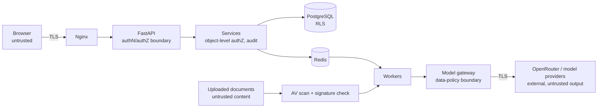

# 04 — Security Model

## 1. Trust boundaries

| Boundary | Threat | Control |
|----------|--------|---------|
| Browser → API | session theft, CSRF, XSS, brute force | HttpOnly `__Host-` cookie, CSRF token, CSP, rate limits, lockout |
| API → services | broken object-level authorisation, role escalation | permission dependency + service-level ownership check on every object |
| Services → DB | cross-tenant leakage, SQL injection | tenant-scoped repositories, RLS, SQLAlchemy bound params only |
| Uploads → processing | malware, polyglots, decompression bombs, prompt injection | size/page limits, magic-byte check, AV, sandboxed renderer, injection handling |
| Workers → LLM | data exfiltration to providers, poisoned outputs | data-policy routing, redaction, schema validation, grounding, monotonic escalation |
| Workers → integrations | SSRF, credential leakage | allow-listed hosts, secrets from secret manager, signed webhooks |

## 2. Authentication

* **Registration:** self-service creates an organisation + first `org_admin` (email verification required in
  production; dev-mode console mailer clearly labelled). Further users are invited by admins.
* **Passwords:** argon2id (`m=64 MiB, t=3, p=4`), min 12 chars, breached-password check via k-anonymity
  adapter (optional, off in dev), no composition rules beyond length.
* **Sessions:** ADR-006. Idle timeout 30 min, absolute 12 h (configurable per org, max 24 h). Session ID rotated on
  login and privilege change. Logout revokes server-side. Admin can revoke all sessions for a user.
* **CSRF:** cookie `claimos_csrf` (not HttpOnly) + `X-CSRF-Token` header must match the session's stored CSRF hash
  for POST/PUT/PATCH/DELETE. `SameSite=Lax` as second layer.
* **Brute force:** per-account and per-IP sliding windows in Redis (5 failures/15 min → 15 min lock, exponential);
  uniform error messages and timing; all attempts in `login_attempts`.
* **MFA:** TOTP for admin/reviewer roles — Phase 13 (schema ready in Phase 2).
* **Login monitoring:** new-device/IP notification, admin view of login activity.

## 3. Authorisation

Permission catalogue (excerpt):

| Permission | super_admin | org_admin | claims_manager | adjuster | fraud_inv | compliance | reviewer | auditor |
|------------|:-:|:-:|:-:|:-:|:-:|:-:|:-:|:-:|
| `org.manage` | ✓ | ✓ | | | | | | |
| `users.manage` | ✓ | ✓ | | | | | | |
| `claims.read` | ✓ | ✓ | ✓ | assigned | assigned/flagged | ✓ | assigned | ✓ |
| `claims.write` | | ✓ | ✓ | assigned | | | | |
| `claims.assign` | | ✓ | ✓ | | | | | |
| `documents.read` | ✓ | ✓ | ✓ | assigned | assigned/flagged | ✓ | assigned | ✓ |
| `documents.upload` / `fields.correct` | | | ✓ | assigned | | | | |
| `processing.start` / `cancel` | | | ✓ | assigned | | | | |
| `fraud.investigate` | | | | | ✓ | | | |
| `reviews.decide` | | | ✓ (authority) | | | | ✓ (authority) | |
| `reviews.escalate` | | | ✓ | ✓ | ✓ | ✓ | ✓ | |
| `policies.manage` / `products.manage` / `rules.publish` | | ✓ | ✓ (draft) | | | | | |
| `ai.manage` (models, prompts, agents) | ✓ | ✓ | | | | | | |
| `compliance.manage` | | ✓ | | | | ✓ | | |
| `audit.read` | ✓ | ✓ | | | | ✓ | | ✓ |
| `reports.generate` | | ✓ | ✓ | assigned | | ✓ | assigned | |

`super_admin` is a **platform** role (provisioning, model registry defaults); it does not grant reading tenant
claim content unless a time-boxed, audited support grant is issued by the org admin.

Enforcement layers:

1. `Depends(require_permission("claims.read"))` on the route.
2. Service-level **object checks** (`ClaimAccessPolicy.can_read(user, claim)`: org match, assignment rules,
   restricted-visibility notes).
3. Repository tenant scoping + RLS (`SET LOCAL app.org_id` at transaction start).
4. Reviewer **authority**: `reviewer_authorities` checked at decision time — amount ≤ `max_approval_amount` in the
   claim currency, product in scope, `can_reject`, `can_override_fraud` for high-risk claims.
5. **Segregation of duties:** the adjuster assigned to a claim cannot be its final approver; four-eyes
   (second approver) required above `approval.four_eyes_threshold` or when overriding a recommendation.
6. Role changes require `users.manage`, cannot grant roles above the granter's own, and are audited.

## 4. Tenant isolation tests (gate for Phase 2)

* User of org A requests claim/document/report/event stream IDs from org B → `404` (not 403, no existence leak).
* Composite FK prevents a claim in org A referencing a policy in org B (DB error).
* RLS test: raw SQL session with `app.org_id = A` cannot see B rows even without WHERE clauses.
* Agent tools: `claims.history_for_customer` with a foreign customer id → `ToolAuthorizationError`.
* SSE: subscribing to another org's claim channel → `404`.
* Object storage keys are never accepted from clients; downloads resolve key from DB by authorised id.

## 5. File upload security

| Control | Detail |
|---------|--------|
| Limits | 25 MB/file, 50 files/claim, 200 pages/document, 40 MP/image, nginx `client_max_body_size` aligned |
| Allow-list | PDF, PNG, JPEG, TIFF, HEIC (converted), DOCX, XLSX/CSV (bank/line items) |
| Signature check | magic bytes via `python-magic`/`filetype`; declared vs detected mismatch → reject |
| Content checks | PDF: reject encrypted/JavaScript/embedded files/launch actions; DOCX: reject macros (`vbaProject.bin`), external relationships; images: decompression-bomb guard (Pillow `MAX_IMAGE_PIXELS`) |
| AV | ClamAV `clamd` adapter; files stay `scan_status=pending` and are not processed until `clean`; dev adapter sets `skipped_dev` and the UI shows a warning banner |
| Storage | random object keys, never user filenames; original filename stored sanitised; `Content-Disposition: attachment` for downloads; preview rendered server-side to PNG |
| Sandboxing | document worker container: non-root, read-only root FS, no outbound network except storage/DB/Redis, CPU/memory limits, per-task timeout |

## 6. AI security

1. **Untrusted-content framing.** Document text is inserted inside `<document id=… page=…>` blocks with an
   instruction that content is data. System prompts are version-controlled and never include tenant secrets.
2. **No mutating tools.** Agents have only read tools bound to the current claim; argument schemas validated;
   tool calls logged in `agent_runs`.
3. **Output distrust.** Strict Pydantic schemas (`extra="forbid"`), enum validation, clause/document IDs must exist
   in the provided context, grounding check, numeric values never taken from LLM for final money.
4. **Monotonic escalation** (ADR-002): model output can only add caution.
5. **Injection detection.** Heuristic + pattern scanner over page text (e.g. "ignore previous instructions",
   role tokens, hidden white/tiny text from PDF layout) → `F-INJECTION` indicator + compliance flag; content still
   processed as data.
6. **No LLM-generated SQL or code execution**, anywhere.
7. **Data-policy routing.** The gateway refuses to send `data_classification="real"` content to any model whose
   `data_policy` is not on the org's approved list or when `ai_data_processing_approved=false`. Optional PII
   redaction (names/IDs/bank numbers replaced with stable placeholders) for text-only prompts.
8. **Secrets.** `OPENROUTER_API_KEY` exists only in worker/API env (secret manager in production); never sent to
   the frontend; outbound requests carry a generic `HTTP-Referer`/`X-Title` app identifier only.

## 7. Data protection

| Area | Control |
|------|---------|
| In transit | TLS 1.2+ at Nginx; internal service TLS in production compose/k8s; DB `sslmode=verify-full` in production |
| At rest | Volume/disk encryption; S3 SSE-KMS (provider KMS; self-hosted S3 gateways must have SSE configured); envelope encryption (AES-256-GCM, key per org) for high-sensitivity columns: national ID, bank account, MFA secret, webhook secrets |
| Minimisation | national ID stored as keyed hash + last 4; bank numbers masked in UI and logs |
| Logging | structlog JSON; redaction processor for known PII keys and patterns; no document text, no prompts with real data in logs (Langfuse capture disabled for `real` data unless self-hosted and approved) |
| Retention | per-org settings by entity (claims, documents, audit, LLM traces); legal hold flag blocks deletion; deletion workflow: request → approval → crypto-erase objects + soft-delete rows → purge after grace period; audit events retained per profile |
| Backups | nightly `pg_dump`/WAL archiving + object versioning; quarterly restore test documented (Phase 13) |
| Headers | CSP (no inline scripts, nonces from Next.js), HSTS, `X-Content-Type-Options`, `Referrer-Policy`, `frame-ancestors 'none'` |
| Rate limiting | Nginx (per IP) + app (per user/org, Redis token bucket) incl. upload and processing endpoints |
| Audit | every mutation, auth event, field correction, model/prompt change, review decision, export and document download |

## 8. Development-mode labelling

`APP_ENV=development` enables adapters: local filesystem storage, console email/SMS, AV `skipped_dev`, mock AI
provider (optional), seeded synthetic data. Each is: logged at startup, shown on the System Health page and as a
persistent banner, and **blocked** when `APP_ENV=production` (startup fails).
