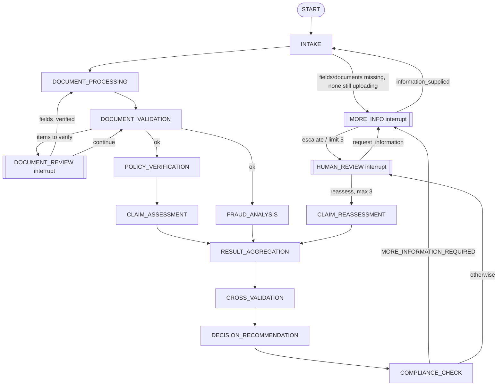

# 08 — Orchestration (Phase 7 implementation)

Implements [02 — Workflow](02-workflow.md) with LangGraph 1.2 over the Phase 6 agents
([07 — Agents](07-agents.md)). Code: `backend/workflows/` (state, nodes, graph, runtime),
`app/services/workflow_service.py`, `tasks/workflow.py`, `app/api/v1/processing.py`.

## 1. Graph as built

Deviations from the design, on purpose:

* **No FRAUD_AMOUNT_CHECKS node.** The fraud agent reads amounts and line items from the documents
  itself, so stage 2 is part of FRAUD_ANALYSIS.
* **CLAIM_REASSESSMENT is its own node.** Re-entering CLAIM_ASSESSMENT would wait forever at the join
  for a fraud branch that does not run again.
* **RULES_ENGINE is inside DECISION_RECOMMENDATION** (the decision agent evaluates the matrix).
* **INTAKE treats uploads still in the pipeline as provided**; DOCUMENT_PROCESSING waits for them and
  re-runs intake afterwards, so missing documents are still caught.
* **No AUTO_APPROVAL_ELIGIBILITY / FINALIZATION / REPORT_GENERATION yet.** STP is Phase 8; approve,
  reject and finalisation are Phase 9 (review workspace); reports are Phase 11. Every run therefore
  ends at HUMAN_REVIEW or MORE_INFO.
* Node results stay in `agent_runs` / `agent_outputs`; the per-domain tables of 01 §3.5
  (`fraud_investigations`, `claim_assessments`, `decision_recommendations`, …) arrive with Phase 9.

## 2. Execution lifecycle

`queued → running → interrupted ⇄ queued → … → completed | failed | cancelled`; at most one
queued/running/interrupted execution per claim (unique index). Claim status moves stage by stage with
`rules_engine.claim_status.path` (each hop recorded in `claim_status_history` and the audit log).

| Concern | Mechanism |
|---------|-----------|
| Checkpoints | `AsyncPostgresSaver`, `thread_id = execution id`; tables created by migration 0007 from the library's own migration list; mirrored into `workflow_checkpoints` |
| Interrupt | `interrupt(payload)` in DOCUMENT_REVIEW / MORE_INFO / HUMAN_REVIEW; the task ends (no worker held); payload carries a one-time `interrupt_id` |
| Resume | `POST /workflow-executions/{id}/resume {interrupt_id, action}`; validated against the pending interrupt's actions; second use → 409; human-review actions need `reviews.decide` |
| Retry | node `RetryPolicy` (2 attempts, backoff, not for cancel/interrupt/agent failure); a failed execution can be retried from its last checkpoint |
| Crash recovery | 15 s heartbeat while running; `beat` runs `workflow.recover_stale` every 15 s; executions with a heartbeat older than 60 s are re-enqueued (max 3) and LangGraph replays from the last checkpoint. A Celery delivery only runs if its task id is the execution's current one, so a late broker redelivery cannot run twice. An agent run left `running` by the dead worker is finalised `failed / WORKER_LOST` before the node re-runs |
| Cancel | `POST /claims/{id}/processing/cancel`: immediate when queued/interrupted, otherwise at the next node boundary or document-wait tick; claim returns to SUBMITTED |
| Limits | 60 node visits, 3 reassessments, 5 information requests, 100 LangGraph steps |
| Events | `workflow_events` is the outbox (gap-free `seq` under an advisory lock, append-only); published to Redis after commit; SSE replays from `Last-Event-ID` and re-reads the table on every wake-up |

## 3. API

| Method | Path | Permission |
|--------|------|-----------|
| POST | `/claims/{id}/processing` (Idempotency-Key) | `processing.start` |
| POST | `/claims/{id}/processing/cancel` | `processing.cancel` |
| GET | `/claims/{id}/executions`, `/workflow-executions`, `/workflow-executions/{id}` | `claims.read` |
| POST | `/workflow-executions/{id}/resume`, `/workflow-executions/{id}/retry` | `processing.start` (+ `reviews.decide` for human review) |
| GET | `/workflow-executions/{id}/events` (text/event-stream) | `claims.read` |

## 4. Known limitations

* The LangGraph checkpoint tables have no tenant column, so RLS cannot apply; only the worker reads
  them and the state holds identifiers and code-generated summaries only (no document text). A
  dedicated orchestrator database role is part of Phase 13 hardening.
* The token budget per execution is recorded (`tokens_used`) but not yet enforced per execution;
  the per-organisation daily budget of the gateway applies.
* Expiry timers for information requests (reminders) arrive with notifications (Phase 11).
